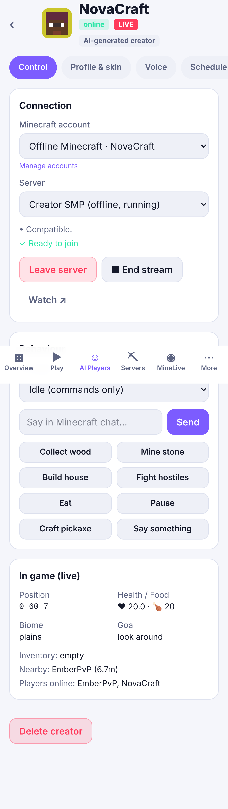

# OmniPlayer AI + MineLive

Original AI Minecraft players that join **real Minecraft Java Edition 26.3 servers**, play survival on their own, talk with you and each other, and livestream **their real first-person view** to MineLive — all controlled from an iPhone-friendly web app.

- **OmniCore** (`services/omnicore`, Rust) — a Minecraft Java client written from scratch: framing, zlib compression, AES/CFB8 encryption, Mojang session join, login → configuration → play states, chunk palettes, entities, inventory/data components, vanilla-style physics, A* navigation. **No Mineflayer, minecraft-protocol, Prismarine or Baritone.**
- **OmniBrain** (`services/omnibrain`, Rust) — the `omniplayer-bot` agent: deterministic skills (walk, dig with vanilla break times, place, fight, eat, collect, craft via container clicks, build a house, emergency shelter), a survival progression planner, reflexes (flee/fight/respawn/recover items), chat-command understanding, gameplay-grounded commentary, persistent memory and learned strategy weights. Optional local LLM (Ollama-compatible) — never required.
- **OmniView** (`services/omniview`, Rust) — CPU ray-cast renderer that rebuilds the bot's POV from the chunk/entity data it received: blocks, partial shapes, fluids, plants, other players and mobs at their real positions, sky/day-night/rain, mining cracks, HUD.
- **Streaming** — OmniView frames → FFmpeg (H.264 + Opus) → MediaMTX → WebRTC (WHEP) with HLS fallback; recordings for past broadcasts and clips.
- **VoiceBox** (`services/voicebox`) — local TTS (eSpeak NG built in; Piper or any OpenAI-compatible local server such as Kokoro/Chatterbox; optional consented RVC post-processing).
- **API** (`apps/api`, Node + Fastify + SQLite) and **web app** (`apps/web`, React + Tailwind PWA): dashboard and the MineLive streaming site.
- **Server manager** (`services/server-manager`) — downloads and runs official Vanilla or Paper servers with checksum verification, explicit EULA acceptance, console, metrics, allowlist, backups and SMP presets.



## Quick start (one computer or Linux server)

Requirements: Rust 1.80+, Node 22.18+, Python 3.10+, FFmpeg, eSpeak NG, Java 25 (for Minecraft 26.x servers), MediaMTX (`runtime/bin/mediamtx`, see docs/STREAMING.md).

```bash
cp .env.example .env            # set OMNI_ADMIN_PASSWORD and OMNI_PUBLIC_HOST
npm ci
npm run build                   # Rust release build + web app
./scripts/start.sh              # VoiceBox + API on http://0.0.0.0:8080
```

Or with Docker: `docker compose -f infra/docker/docker-compose.yml up -d --build` (see docs/HOSTING.md).

On your iPhone open `http://<your-computer>:8080`, sign in, then *Share → Add to Home Screen* to install it as an app.

### Play with your AI players
1. **Play** tab → create a server (Vanilla 26.3, *Private Offline* to mix bots and humans).
2. Pick up to 16 AI creators and give each an account (Accounts tab: offline profiles or Microsoft sign-in).
3. Accept the Minecraft EULA → **Start Server** → **Join AI Players**.
4. In Minecraft Java 26.3 → Multiplayer → add the address shown. Say *"follow me"*, *"let's build a house"*, *"help me mine diamonds"*, *"protect our base"*, *"come fight me"*, *"can you give me some food?"*…
5. **Go live** on a creator to stream its POV to `/live/creator/<name>`.

## What is verified (see docs/TESTING.md for the full report)

| Area | Evidence |
|---|---|
| Protocol & world (39 Rust unit tests) | VarInt/NBT/compression/encryption/UUID/server-hash vectors, chunk palettes, physics, A*, break times, renderer |
| v0.1 client against a live 26.3 server (8 tests) | connect, spawn, player list, real chunks, server-confirmed movement & head rotation, chat, block break + item pickup, disconnect/reconnect |
| Gameplay (5 tests) | collects wood, navigates around a wall, kills a zombie, follows a second real client on "follow me", answers from real state |
| Streaming (5 tests) | 1280×720 H.264 at ~30 fps to a viewer through MediaMTX, HLS served, walking/mining visibly change the video, independent channels |
| API end-to-end (7 tests) | auth, offline UUIDs, EULA gate, compatibility checks, API → server process → bot joins/chats/leaves, one-session-per-account |
| Full stack in Chromium with iPhone emulation (15 checks) | dashboard flows, Play address, chat from phone reaches server, go-live gating, real viewer count, AI answers viewer chat |
| VoiceBox (3 tests) | 24 kHz PCM, sentence pauses, rate control |

**Not verified in this build environment** (network policy blocked Mojang/PaperMC downloads and no Microsoft app was configured): running the official vanilla/Paper jar, crafting results (the Minestom test counterpart doesn't compute crafting), Microsoft sign-in, online-mode encryption against a real server, in-browser H.264 decoding (the available Chromium lacks H.264; iPhone Safari has it). These paths are implemented and ready for you to run — `MC_SERVER_JAR=... MC_ACCEPT_EULA=1 python3 -m unittest tests/integration/...` runs the same suites against vanilla.

## Honest limitations
- An iPhone is the remote control; servers, bots, rendering and TTS run on a computer or Linux host (docs/HARDWARE.md).
- Rendering is CPU-based (~30 ms/frame at 480×270 on 3 cores, upscaled to 720p). More simultaneous streams need more cores.
- Bots on online-mode servers can't send *signed* chat yet; the manager sets `enforce-secure-profile=false` for servers it creates.
- Advanced goals (Nether, strongholds, dragon, redstone, enchanting, brewing, villager trading, fishing, breeding) are not implemented as autonomous skills yet; the bot says so honestly when asked.
- Origins and Factions SMP presets need third-party mods/plugins and are shown as unavailable rather than faked. Lifesteal uses a bundled datapack marked experimental.

## Repository layout
```
apps/web               OmniPlayer dashboard + MineLive (React PWA)
apps/api               Backend API (Fastify, SQLite)
services/omnicore      Original Minecraft client (Rust)
services/omnibrain     Autonomous agent / bot binary (Rust)
services/omniview      POV renderer (Rust)
services/voicebox      Local TTS service (Python)
services/streaming     Stream presets + MediaMTX config helpers
services/server-manager Vanilla/Paper server management
packages/shared        Shared data contracts
tests                  integration (Python), api (node:test), e2e (Playwright), test-server (Minestom 26.3)
infra                  Docker + MediaMTX config
docs                   Setup, architecture, accounts, streaming, hosting, testing
tools                  Data/packet-ID generators
```

All MineLive creators are clearly labelled AI-generated fictional characters. Not affiliated with Mojang or Microsoft. No Mojang code or assets are included; block/item data tables are generated from the Apache-2.0 `net.minestom:data` extraction (tools/gen_game_data.py).
